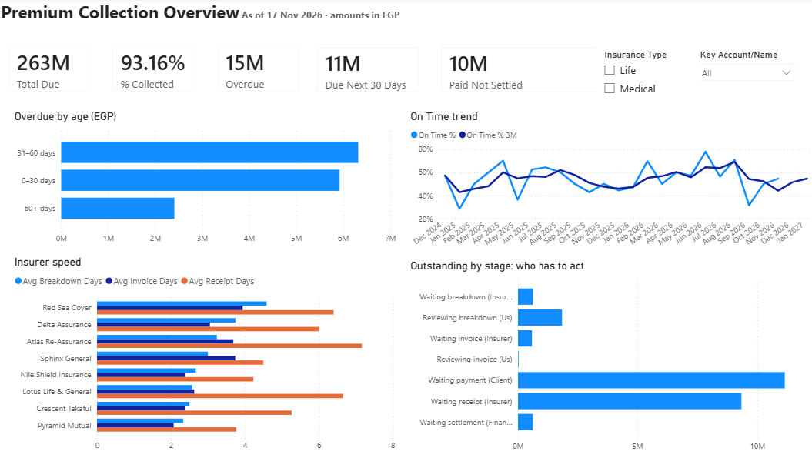
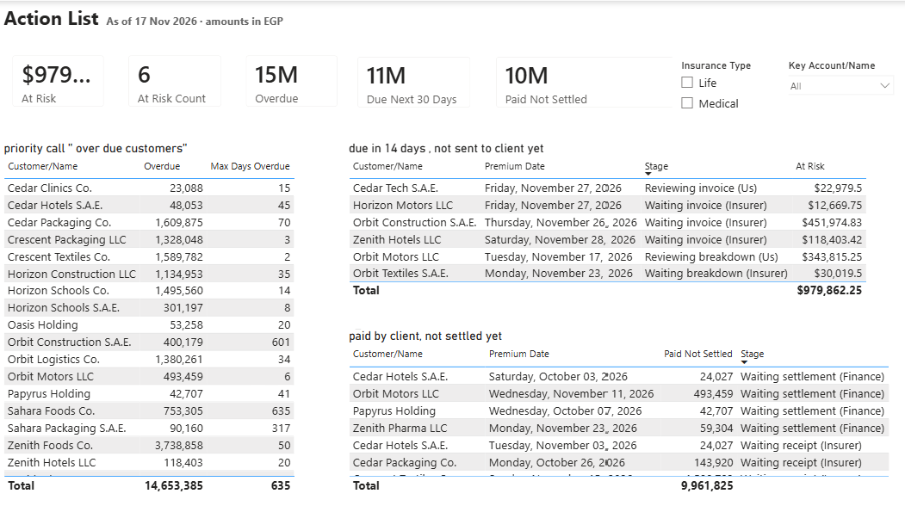
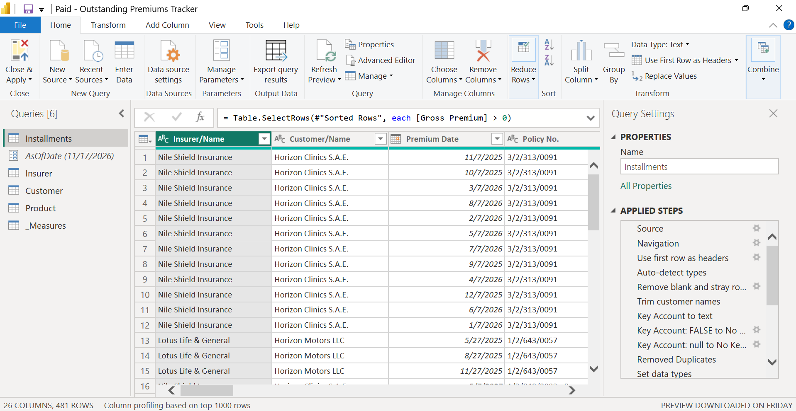
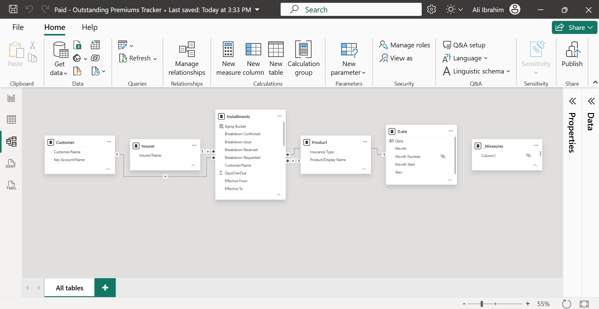
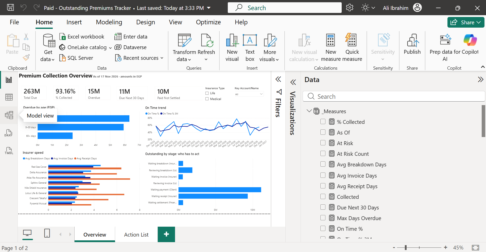

# Insurance Collections Insights - Where Payments Get Stuck

### Power BI dashboard · an insurance broker case study

> **The real question isn't "why is this premium late?" but "who's holding it?"** The same overdue total splits into four queues: waiting on the broker's review, on the insurer, on the client, or on finance. Each needs a different person to act. In this data, 41% of "overdue" premiums (EGP 6.07M) were already paid by clients and stuck waiting on insurer receipts, so the follow-up belonged with insurers, not clients.

**Power BI dashboard for insurance premium collections and accounts receivable**: Power Query data cleaning, star schema data modeling, DAX measures, aging analysis, and an action list of overdue and at-risk premiums.

It tracks premium collection at an insurance broker: not just **what** is late, but **where each premium is stuck** and **who has to act**.

> Built on **mock data** that mirrors a real Odoo export and the real collection process I worked with at an insurance broker. No real client data is used.



---

## The problem

At a broker, premiums are tracked from a weekly Odoo export of "outstanding" installments. That list answers one question, *what hasn't been paid?*, but not the ones the team actually needs:

- Is the money late because of the **client**, the **insurer**, **finance**, or **us**?
- Which premiums will become overdue next week unless someone acts today?
- Which "overdue" clients have actually already paid?

## Key findings

| Finding | Number |
|---|---|
| Overdue premiums, of which clients had **already paid** (waiting on insurer receipts or finance) | **6.07M of 14.65M EGP (41%)** |
| Clients paid on time when they got the invoice **10+ days** before the due date | **78%** (vs 0% when it arrived after the due date) |
| Overdue money held by just **3 of 11** client groups | **58%** |
| Premiums due in the next 14 days with **no invoice sent yet** (at risk) | **6 premiums, 0.98M EGP** |
| Breakdowns sent back because they were wrong | **44%** (Medical 50% vs Life 33%) |

**The takeaway:** a big part of "overdue" is a process problem, not a client problem. Getting breakdowns and invoices out earlier, and chasing insurers' receipts, would do more than chasing clients.

## The dashboard

**Page 1, Overview: how are we doing?**
KPI cards (Total Due, % Collected, Overdue, Due in 30 days, Paid not settled), overdue by age (0–30 / 31–60 / 60+ days), on-time payment trend with a 3-month rolling average, insurer turnaround in working days, and outstanding money by process stage. Slicers for key account and insurance type.

**Page 2, Action list: who has to act today?**
Overdue customers to call, at-risk premiums (due in 14 days, not yet sent to the client), and premiums the client has paid but that are not yet settled in Odoo.



## The data

`data/mock_premium_report.xlsx`: 487 raw rows (481 after cleaning), generated by `data/generate_mock_premiums.py` with a fixed seed, so anyone gets exactly the same data.

- **Same layout as the Odoo outstanding-premiums export:** insurer, customer, premium date, policy no., net/gross premium, insurance type, product, key account, effective dates, status.
- **Plus one date per step of the real collection chain:**
  breakdown requested → received → confirmed → invoice received → sent to client → client pays (proof of payment) → insurer receipt → settled in Odoo.
- **Realistic export quirks** left in on purpose: blank and stray rows, extra spaces, duplicates, refunds, empty key accounts exported as `False`.
- **Snapshot date:** 17 Nov 2026. Every status and calculation uses this as-of date, not "today", so the numbers never change between viewings.

## How it was built

1. **Power Query (cleaning pipeline):** removed blank rows, trimmed names, fixed `False` key accounts, removed duplicates and refunds, set data types. Every step is recorded, so a new export cleans itself on Refresh.

   

2. **Calculated columns:** Days Overdue, On Time (paid by the premium date), and **Stage**, which reads the process dates in order and stops at the first missing one to show where each premium is stuck.
3. **Star schema:** one fact table (Installments) and four dimensions (Date, Customer + Key Account, Insurer, Product), with one-to-many relationships.

   

4. **DAX measures (15+):** money KPIs, At Risk, Paid Not Settled, insurer turnaround with `NETWORKDAYS` (Friday–Saturday weekend), and on-time % with a 3-month rolling average using `DATESINPERIOD`. `KEEPFILTERS` keeps table rows correct when a measure filters dates.

   

## Validation

The headline numbers were checked against a separate calculation in SQL (see the companion SQL project): the same 481 clean rows, 45 customers, 263.4M due and 14.65M overdue come out of both tools, built with different cleaning code. Validating in two independent tools catches mistakes like missed duplicates or a reversed filter before anyone sees the dashboard.

## Limitations and next steps

- **Mock data:** the patterns come from my experience of the process; with real data, I'd test whether they hold.
- **Turnaround averages** include only finished steps, so an insurer that never answered can look faster than it is.
- **Working days** ignore public holidays; a holiday table would fix that.
- **Next:** publish to Power BI Service with scheduled refresh, add Account Manager to the customer dimension, and make the at-risk window a user parameter.

## Files

```
├── outstanding-premiums-tracker.pbix   # the Power BI report (open with Power BI Desktop)
├── data/
│   ├── mock_premium_report.xlsx         # mock Odoo-style export (487 rows)
│   └── generate_mock_premiums.py        # recreates the data exactly (seed 77)
└── screenshots/                         # images used in this README
```

## Related project

**SQL analysis of the same data:** [insurance-collections-insights-sql](https://github.com/alytareq101/insurance-collections-insights-sql): 8 business questions answered in MySQL, including a hypothesis test.

---

**Author:** Aly Tarek · [LinkedIn](https://www.linkedin.com/in/aly-tarek-432245411)
**Tools:** Power BI (Power Query, DAX, star schema) · Python (mock data generation)

**GitHub topics:** `power-bi` `dax` `power-query` `data-analysis` `data-visualization` `dashboard` `insurance` `accounts-receivable` `collections` `star-schema` `portfolio-project`
